<div align="center">

# qweninqwen

**A real Qwen, executed by the weights and recurrent state of another Qwen.**

A homage to [Qwenputer](https://github.com/divagr18/qwenputer), in which a CPU lives inside Qwen's weights. Here the machine runs a language model.



</div>

> **Status in one paragraph.** A complete **toy** inner Qwen3-architecture model (random weights, d=128, 2 layers, vocab 512) generates tokens end to end inside a stock `Qwen3_5ForCausalLM`: outer logits match the Hugging Face model to 5e-7..1.9e-6 at every step and the generated tokens are identical. The toy is a debugging and validation vehicle, **not the real model**. For the real Qwen3-0.6B, the pieces are verified separately: all 197 weight matrices are paged through DeltaNet state and contracted in-model (relative error 5.6e-7, 41.95 s on an A10G, teacher-forced harness-fed activations), and the non-matvec operations (RMSNorm, SwiGLU, RoPE + softmax attention with KV, an argmax over the full 151,936-token vocabulary) are verified at full inner dimensions. **A real-dimension chained token has not been produced yet; it is in progress.** See [What is verified today](#what-is-verified-today) and [Status by tier](#status-by-tier).

## The idea in 30 seconds

- The **outer** model is an unmodified `Qwen3_5ForCausalLM` from `transformers` (GatedDeltaNet layers, SwiGLU MLPs, RMSNorm, full-attention layers). Only its weights are written; its code is not patched.
- The **inner** model is the smallest real Qwen (Qwen3-0.6B or Qwen2.5-0.5B) with its real weights. No scaled-down variant is ever presented as a result.
- A DeltaNet layer is an associative memory: the delta rule writes a value `v` at key `k`, and a query `q` reads back `S^T q`. With one-hot keys, **writing a weight row and reading with an activation is a matrix-vector product**. Inner weights are paged through that state.
- RMSNorm, SwiGLU, RoPE and softmax attention are compiled into the outer model's norm, MLP and attention layers. The outer KV cache is the inner KV cache.
- The host only streams weights, tokens, embeddings, addresses and position ids, and performs the outer argmax and append. It never computes an inner activation.
- Speed is allowed to be absurd. The honest accounting is in [the cost model](#cost-model). Correctness and the host rules are not negotiable.

## Architecture

The host feeds frames (vectors of the outer model's hidden size) into the outer stack. Three kinds of outer layers do three different jobs:

| Outer component | Role for the inner model | Where |
|---|---|---|
| GatedDeltaNet layers | Paged weight memory. A WRITE frame sets one key row of the state to a weight row; a READ frame contracts an activation against all written rows. K-tile accumulation happens in the out-projection and the residual sum. | `experiments/state/engine.py` |
| Compiled MLP / norm layers | Inner RMSNorm (exact for any `d`, `eps`), SwiGLU `silu(gate)*up`, residual and copy gadgets, elementwise products. | `experiments/ops/ops.py` |
| Full-attention layers | Inner RoPE (rotate-half, theta), GQA, causal softmax with the inner KV held in the outer KV cache; also the in-model argmax over the vocabulary. | `experiments/ops/ops.py` |
| Outer `lm_head` | Decodes the 18-bit address code produced by the in-model argmax into the outer token id. | `experiments/ops/ops.py` |

The outer layers are strictly feed-forward: layer `l` at step `t` sees only the outputs of earlier layers at step `t` and the state of layer `l` from earlier steps, and that state only contains functions of layers shallower than `l`. State and KV therefore carry data **deeper** in the stack, never back to shallower layers. The consequence, and the design basis of the toy, is an **unrolled pipeline in depth**: every inner op gets its own outer layers in dependency order, and a register is a DeltaNet layer placed between the op that writes it and the op that reads it. One inner token is one outer forward call (a chunked prefill of the WRITE frames followed by the READ frame of each bank). Roughly 15 outer layers are needed per inner layer, and every frame flows through all of them. Contract and hazards (L2-normalised q/k, conv SiLU, gated RMSNorm, ballast trick): [`docs/INTERFACE.md`](docs/INTERFACE.md) (section 5b supersedes section 5, which assumed per-round state hand-off).

### DeltaNet state as weight memory


### How a token is computed


1. **Embed.** The host places the embedding row of the current token in the stream (a lookup, no arithmetic) together with position id (the inner token clock) and flags.
2. **Per inner layer, in depth order.** RMSNorm (a GDN gated-RMSNorm head, or a norm layer); the `W_qkv` bank (WRITE frames load weight rows into DeltaNet state, the READ frame contracts the activation against them); a register layer; for Qwen3, q/k norm plus a gain product in MLP gadgets; RoPE and softmax attention in an outer full-attention layer that appends to and reads the KV cache; `W_o` and the residual add; the second RMSNorm; `W_gate, W_up`; SwiGLU in an MLP layer; `W_down` and the residual add.
3. **After the last layer.** Final RMSNorm, the LM-head contraction, and an in-model hard-max attention over all vocabulary positions whose value is the address code of the winner; the outer `lm_head` decodes the code.
4. **The host does the outer argmax and appends the token.** That is the only host-side decision and the only deep-to-shallow channel.

This is exactly what the toy executes today (all of steps 1 to 4, on a tiny random model). Doing it at real dimensions is the open work: the stock config is uniform per layer, so `D x depth` parameters get large for the real model (the toy's outer is already 2.02 B parameters), which calls for layer-streamed execution or a smaller outer width.

## What is verified today

Only claims with a result file or a test in this repository are listed.

| Claim | Evidence |
|---|---|
| **Toy end to end.** A random-weight Qwen3-architecture inner model (d=128, 4 q / 2 kv heads of 32, inter 256, 2 layers, vocab 512, q/k-norm) generates 4 prompt + 4 generated tokens inside a stock `Qwen3_5ForCausalLM` (34 layers, D=5641, 2.02 B fp32 parameters): outer logits vs Hugging Face 5e-7..1.9e-6 at every step, argmax identical. All norms, matvecs (GDN state banks), registers, SwiGLU, q/k-norm gain products, RoPE/GQA/KV attention and the LM head run in the outer model; the host writes flags, one-hot addresses, position ids, SiLU-pre-inverted gain-folded weight payloads and the embedding row, and does argmax + append. 1530 outer steps and about 12 to 14 s per inner token on an A100. **Toy only: tiny and random, not Qwen3-0.6B.** Reported from an A100 run; not re-run on the machine that built this repository. | [`experiments/vslice/VSLICE_RESULTS.md`](experiments/vslice/VSLICE_RESULTS.md), `experiments/vslice/vslice.py`, `experiments/vslice/toy_test.py` |
| All 197 weight matrices of Qwen3-0.6B (28 layers + LM head, 595,984,384 real weights, 519,430 outer frames) are written into DeltaNet state and contracted in-model on an A10G in 41.95 s; worst relative error vs an fp64 reference 5.6e-7; argmax identical on all 197 matrices. **Activations were harness-fed (random) and the matrices were not chained: this is not a real token.** | [`experiments/run/token_results.jsonl`](experiments/run/token_results.jsonl), [`experiments/run/README.md`](experiments/run/README.md), `experiments/run/run_token.py` |
| Whole Qwen3-0.6B LM head (151,936 x 1024) through the state bank: 3.70 s on an A100 (nL=2), error 3.8e-7 | [`experiments/run/a100_results.jsonl`](experiments/run/a100_results.jsonl) |
| RMSNorm at full dims on real activations: 1.0e-7 to 1.7e-7 (max error / max abs), `eps` handled exactly | [`experiments/ops/res_norm_swiglu_fp32_1e+08.json`](experiments/ops/res_norm_swiglu_fp32_1e+08.json) |
| SwiGLU (4864 / 3072 neurons): 1.8e-8 to 1.9e-7 | same file |
| Softmax attention with RoPE, GQA, causal mask and KV (T=25, four layers each of Qwen2.5-0.5B and Qwen3-0.6B): 6.6e-7 to 1.3e-5 | [`experiments/ops/res_attn_fp32.json`](experiments/ops/res_attn_fp32.json) |
| Qwen3 per-head q/k norm plus streamed gain: 2.9e-7 to 3.1e-7 | [`experiments/ops/res_misc.json`](experiments/ops/res_misc.json) |
| In-model argmax over the full 151,936 vocabulary through attention and an outer `lm_head`, correct on all 4 tested positions for each of Qwen2.5-0.5B and Qwen3-0.6B (smallest margin 0.14 logits); 18 to 44 s per argmax on a Mac CPU | [`experiments/ops/res_argmax_q25.json`](experiments/ops/res_argmax_q25.json), [`res_argmax_q3.json`](experiments/ops/res_argmax_q3.json) |
| bf16 outer models are only at noise level (0.1% to 3.6%, Qwen2.5 layer 0 13%); fp32 is the supported mode | [`experiments/ops/res_attn_bf16.json`](experiments/ops/res_attn_bf16.json), [`res_norm_swiglu_bf16_1e+08.json`](experiments/ops/res_norm_swiglu_bf16_1e+08.json) |
| HostGuard catches host-side inner math (bad matmul, softmax, silu, add, RMS, numpy/math calls, hidden readbacks, forward hooks, feeding outer output back) and passes a clean driver; the outer-model integrity check rejects patched forwards, subclasses and modifying hooks | `audit/test_hostguard.py`, `audit/test_outer_check.py` (both print `ALL OK`; re-run them yourself, see [How to run](#how-to-run)) |
| Circuit-route baseline (bit-level arithmetic in GDN state, CPU bf16): 14.7 MAC/s on a real 896-element row, 458 to 488 MAC/s on small synthetic tiles | [`experiments/bench/circuit_baseline/`](experiments/bench/circuit_baseline/), [`experiments/bench/RESULTS.md`](experiments/bench/RESULTS.md) |
| Outer-stack step throughput (A100, random 3.4 B-parameter outer, torch reference GDN): 2219 steps/s fp32 chunked prefill vs 25 steps/s single-step decode | [`experiments/bench/RESULTS.md`](experiments/bench/RESULTS.md) |
| Earlier hosted-nesting experiment: Qwen3-0.6B inside Qwen3.5-0.8B with exact fp32 agreement | [`older/hosted-nesting/README.md`](older/hosted-nesting/README.md) |

Reported in a findings file but without a result file in the repository (treat as reported, not independently reproducible from committed outputs): an alternative exact matvec built from SwiGLU as a multiplier, `silu(w)x + silu(-w)(-x) = wx`, about 1e-6 relative error on real Qwen2.5-0.5B `q_proj` and `down_proj`, and 0.64 to 1.14 s per 494 M weights of MAC throughput on an A100 (this figure assumes the host copies the activation into every weight step, which the audit flags as outside the rules until replaced by an in-model read) ([`experiments/alt/FINDINGS.md`](experiments/alt/FINDINGS.md), code in `experiments/alt/`). The same file records that using the KV cache as weight storage was ruled out.

## Status by tier

| Tier | What runs inside the outer Qwen's weights | Status |
|---|---|---|
| T0 | A single signed MAC / gadget (state write + read, SwiGLU multiplier, norm, product) | **Verified** in isolation, teacher-forced inputs (errors in the table above) |
| T1 | A full projection on real weights, accumulation inside the model | **Verified for all 197 matrices of Qwen3-0.6B**, teacher-forced (harness-fed activations), rel. err 5.6e-7. Chaining the output of one matrix into the next is demonstrated only in the toy. |
| T2 | A real decoder op chain: norm, QKV, RoPE, attention with KV, SwiGLU | **Partial.** Each op is verified at full inner dims on real activations; the ops are chained with the matvecs only in the toy, not at real dimensions. |
| T3-toy | A complete toy inner model (random weights, 2 layers, d=128) generates tokens entirely inside the outer weights | **Achieved** (validation vehicle, not the real model) |
| T3 real | Real Qwen3-0.6B (or Qwen2.5-0.5B) produces a token entirely inside the outer weights | **In progress; not yet achieved.** |
| T4 | Measured cost model for the full model | **Partial.** Weight streaming is measured (41.95 s per token's worth of weights on an A10G); the op layers are not yet measured at real dimensions; the toy's full-token time (12 to 14 s on an A100) is not a real-model figure. |

Known open items, from the agents' notes and the audit ([`audit/AUDIT.md`](audit/AUDIT.md)): the chain from one op's output to the next op's input exists only in the toy; the audit (written before the toy) measured that streamed READ frames differ when host randomness changes in the per-matrix drivers, so those are not token-independent, and the toy has not been audited; the BALLAST constant differs between modules (`machine.py` 2^27, the state engine 1e6) and one value must be chosen for a shared model; the outer argmax/append loop has only been exercised in the argmax test, with logits host-injected; per-layer RMSNorm gain vectors need a vector write path (or folding into the streamed weights, which is exact); the large `XS` scale of the norm trick must end a round; K accumulation across tiles for small banks; bf16 is not exact; no long-context attention test (T=25 only); no longrope test.

## Cost model



Measured: **41.95 s** for the weight-streaming part of one Qwen3-0.6B token on an A10G with the torch reference GDN kernel and an `nL=4` bank (12.4 k frames/s). Estimates, labelled as such in the figure: smaller banks are faster per frame, and the extrapolated 7 to 19 s come from the runner's `plan()` function, not from a run. Not included in any measured number: the op layers and the deeper pipeline they require (about 15 outer layers per inner layer, so every frame costs several times more than in the bank-only run), and the in-model argmax (18 to 44 s on a Mac CPU, not yet measured on GPU). Frame cost scales roughly with the square of the bank size and the path is fp32 compute-bound, not bandwidth-bound.

### Circuit route versus state-as-memory route



The circuit route in [`reference/`](reference/nested-qwen-lab) emulates arithmetic bit by bit in GDN state. Extrapolating its measured rates to 494 M projection MACs gives between about 12 days (488 MAC/s, small synthetic tiles) and about a year (14.7 to 15 MAC/s, real-weight rows) per token, before any non-matvec operation. The state-as-memory route moves the same contraction into the delta-rule read, which is why the weight-streaming measurement above is about six orders of magnitude faster than the slower circuit number. That comparison is matvec against matvec; a full chained token for the state route is not yet measured.

## The honesty rules

What the host **may** do: write BALLAST (a constant), control flags, one-hot address fields, inner weight rows (transport and reformatting only: transpose, pad, tile, quantise and dequantise, per-row shifts and the SiLU pre-inversion of the payload, which depend on weights alone), token ids and embedding rows, `position_ids` (the inner token clock, needed for RoPE continuity), the outer argmax and append, and read outputs for validation only.

Weight-only host arithmetic is allowed but must be disclosed (it never depends on a token): SiLU pre-inversion of the payload, compensation of the outer RMSNorm scale on weight/flag frames, folding RMSNorm gains and biases into streamed weights, and compile-time constants. The audit lists each of these.

What the host **may not** do: compute any inner activation, matmul, norm, softmax, RoPE rotation, nonlinearity or sampling; feed a readback value into the next input; modify the outer model's code (hooks that compute, patched `forward`, subclasses); or use the HF inner model anywhere except as a reference for checks.

### How to audit

[`audit/`](audit/) is the HostGuard harness. It does not trust the drivers:

- `hostguard.py` intercepts every ATen op with a dispatch mode. Outside the outer forward, matmul-like, softmax-like and norm-like ops are violations; elementwise arithmetic is a violation unless declared as `transport(...)`; unknown ops are violations (strict). Argmax is only permitted on tensors derived from outer logits. Readbacks of anything but outer logits are violations unless declared `validation_read(...)`. Numpy and `math` compute calls from user code are caught on a best-effort basis.
- `outer_check.py` checks that the outer model really is the stock `Qwen3_5ForCausalLM`: no class `forward` monkeypatch, no subclass, no modifying hooks, no swapped `gdn_impl` without being listed.
- `static_scan.py` is an AST scan for host-side math the dynamic guard cannot see (for example ndarray `@`).
- `run_audit.py` runs any driver under the guard and exits non-zero on violations. Two demo drivers are included: `demo_good_driver.py` passes, `demo_cheat_driver.py` (a host `bmm`) fails.
- `compare.py` / `compare_runs.py` compare in-model traces against an HF inner reference per op (T1 op, T2 layer, T3 model).

Limits: the guard is a strong check, not a proof. Declared scopes (`transport`, `weight_prep`, `reference`) are listed in its report so a reviewer can read them, and a human still has to read those. **The chained toy driver (`experiments/vslice`) has not been run under HostGuard yet; no audit result for it exists.** The audit so far ([`audit/AUDIT.md`](audit/AUDIT.md)) ran HostGuard on the CPU-sized state-engine and glue tests (pass, with declared scopes) and read the GPU drivers without executing them; it found no host arithmetic on activations inside what is claimed today, and found that all current results are teacher-forced. The GPU paging runner (`experiments/run/run_token.py`) was read, not run under HostGuard. The audit predates the toy.

## Repository layout

```
README.md
docs/
  INTERFACE.md           outer-machine interface: layout, frames, what the host may do, depth ordering
  assets/                SVG figures (architecture, state memory, unrolled pipeline, cost, comparison)
  make_figures.py        regenerates the SVGs from the numbers quoted in this README
qweninqwen/
  machine.py             Layout, make_outer (zeroed stock Qwen3_5ForCausalLM), BALLAST
experiments/
  state/                 matvec in DeltaNet state: engine.py (frame protocol), tiled.py, tests
  ops/                   non-matvec ops in outer layers: ops.py, tests, res_*.json results
  alt/                   alternative matvec: SwiGLU-as-multiplier (mlpmul.py), findings
  run/                   full-model weight-streaming runner and its measured results
  vslice/                end-to-end toy inner model inside the outer model (T3-toy) and its results
  bench/                 outer step throughput, circuit-route baseline results
audit/                   HostGuard, outer-model check, static scan, demo drivers, AUDIT.md findings
reference/              the original circuit-based Qwen-in-Qwen lab (bit-level arithmetic in GDN state)
older/
  hosted-nesting/        earlier hosted-nesting experiments: Qwen3-0.6B hosted in Qwen3.5-0.8B (exact)
  hosted-multi-model/    earlier prototype: several models hosted in one checkpoint
```

The `experiments/` files are working code copied from the agents' benches. Modules import each other by sibling directory (see the `sys.path` lines at the top of each file), so run scripts from inside their own directory.

## How to run

Requirements: Python 3.11, `torch`, `transformers` 5.x (tested with 5.20.2), `safetensors`, and the Qwen checkpoints in the Hugging Face cache (`Qwen/Qwen3-0.6B`, `Qwen/Qwen2.5-0.5B`). GPU scripts expect CUDA and fp32 with TF32 off. Setting `NOFLA=1` forces the torch reference GDN path, which was the fastest correct one measured.

```sh
# audit harness self-tests and demos (CPU, seconds)
cd audit && python test_hostguard.py && python test_outer_check.py
python run_audit.py demo_good_driver.py      # AUDIT RESULT: PASS
python run_audit.py demo_cheat_driver.py     # AUDIT RESULT: FAIL

# state engine
cd experiments/state && python test_silu_inv.py && python test_tiled.py

# ops at full inner dims (writes res_*.json)
cd experiments/ops && python test_norm_swiglu.py fp32 1e8 && python test_attn.py fp32

# end-to-end toy (A100 reported; needs ~8 GB for the 2 B-parameter outer)
cd experiments/vslice && python toy_test.py 4

# the full-token weight-streaming measurement (GPU; args: model nL layers lm_head)
cd experiments/run && NOFLA=1 python run_token.py q3 4

# regenerate figures
python docs/make_figures.py
```

## Credits

- **Qwenputer** ([divagr18/qwenputer](https://github.com/divagr18/qwenputer)) is the idea this repository is a homage to: a computer whose circuits are Qwen's own weights. Its Qwen-in-weights compiler is vendored under `reference/nested-qwen-lab/qwentpu` with its license.
- **The qwentpu reference** (`reference/nested-qwen-lab`) is the circuit-based Qwen-in-Qwen lab whose measurements form the baseline above.
- **Qwen** models by the Qwen team at Alibaba (Qwen3.5 as the outer model; Qwen3-0.6B and Qwen2.5-0.5B as the inner models), Apache-2.0.
- Built on Hugging Face `transformers`.

## License

Code in this repository is MIT (see `LICENSE`); vendored reference code keeps its own license file. Qwen model weights are Apache-2.0, licensed by Alibaba.
