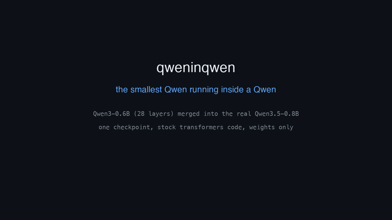
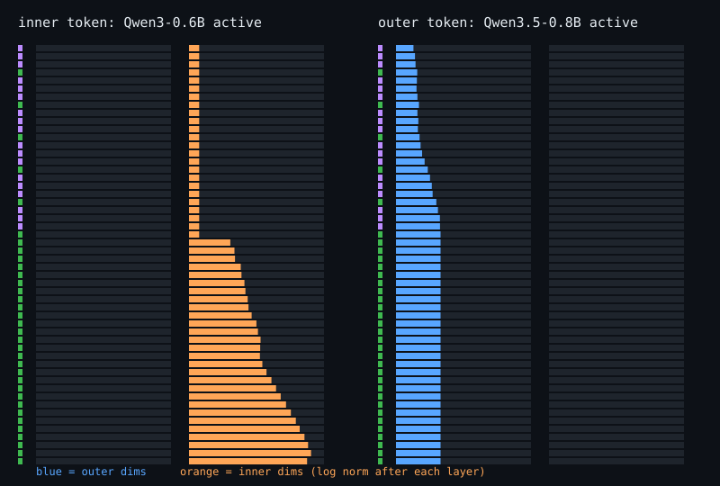

<div align="center">

# qweninqwen

**The smallest Qwen actually running inside a Qwen.**

Qwen3-0.6B (all 28 layers, real weights) is **hosted** inside the real, pretrained Qwen3.5-0.8B,
in a single checkpoint, executed by stock `Qwen3_5ForCausalLM` code. No patches, weights only.

> **Read this:** this is the *fast, exact* variant (v1, "hosted"): the two models share one forward pass but never mix; the outer half idles while the inner runs.
> It is **not** the Qwenputer-style version where the outer model's own DeltaNet weights *execute* the inner model's arithmetic.
> That route (the original `reference/`, about a year per token) is being built as v3; see Roadmap.



[demo video (mp4)](assets/demo.mp4) &nbsp;·&nbsp; real tokens, real timings and real per-layer activations recorded on an A100 (`scripts/trace_demo.py`)

</div>

## How it works



The merged model has hidden size 2080: dims `[0,1024)` belong to the outer Qwen3.5-0.8B, `[1024,2048)` to the inner Qwen3-0.6B, plus one flag dimension. Every weight matrix is block-diagonal, so each model only reads and writes its own half. The first 24 layers are the outer model's own; 28 full-attention layers are appended for the inner model. Token ids below 248320 run the outer model, ids from 248320 up run the inner one. The vocabulary rows are literally concatenated.

Both halves are not just "present", they are exactly isolated. The chart below is measured from the checkpoint: while an inner token runs, the outer half of the residual stream is exactly zero, and the other way round.



### Making stock Qwen3.5 behave like two different models (weights only)

| Obstacle | Fix |
|---|---|
| RMSNorm now averages over 2080 dims | norm weight x sqrt(1024/2080), and `rms_norm_eps` scaled by 1024/2080 so eps is exact too |
| Per-head q/k norm with a wider head (640 vs 256 / 128) | zero-padded dims plus a zero-weight scaled copy of the real dims, so the norm sees the original sum of squares |
| Linear-attention gated norm (outer GDN layers) | `linear_value_head_dim` 260 (= 128 x 2080/1024), extra channels zero |
| Different RoPE: outer 64 dims @ theta 1e7, inner 128 dims @ 1e6 | one shared frequency grid 10^(-k/32), k = 0..223; outer pair j sits at k = 7j, inner pair i at k = 3i |
| Qwen3.5 attention output gate | inner heads read the flag dim with weight 2^26, so sigmoid is exactly 1; outer-token gates are untouched |
| Attention scale 1/sqrt(head_dim) | folded into the q norm weights |
| Outer logits must not win during inner mode | outer `lm_head` rows read the flag with weight -2^26 |
| GQA group size | outer kv heads duplicated so both models use group size 2 |

Details: `qweninqwen/merge.py`.

### Why not the circuit approach?

`reference/nested-qwen-lab` (the original reference) emulates arithmetic bit by bit in GDN state and measured ~500 MAC/s, about a year per inner token for a 0.5B model. This repo embeds the inner weights directly, so the inner model runs at ordinary model speed.

## Results

| Check | Result |
|---|---|
| Checkpoint save / load roundtrip | 15 GB `model.safetensors`, `from_pretrained` then generate works in both modes |
| fp32 exactness, inner vs standalone Qwen3-0.6B | max abs logit diff 6.7e-5, argmax identical at all 147 positions, 32-token greedy text identical on 10/10 prompts |
| fp32 exactness, outer vs untouched Qwen3.5-0.8B | max abs logit diff 6.1e-5, argmax identical at all 150 positions, 32-token greedy text identical on 10/10 prompts |
| bf16 (A100), 10 prompts, top-1 where reference has a clear margin | 147/147 inner, 150/150 outer positions agree (`tests/test_merged.py`) |
| Mutation: zero 12 inner MLPs | output collapses to `........`, so the inner weights do the work |
| Speed (A100, HF eager, no fused kernels) | 11.4 tok/s nested vs 27.7 tok/s plain Qwen3-0.6B (v1 numbers) |

bf16 is not bit-identical to the standalone model: greedy text can diverge at near-tie tokens because accumulation order differs. fp32 is the strict test.

## Quickstart

```bash
pip install -r requirements.txt
python scripts/build_checkpoint.py ckpt/            # ~1 min on GPU, writes ~15 GB
python scripts/generate.py ckpt/ "The capital of France is"          # inner Qwen3-0.6B
python scripts/generate.py ckpt/ "The capital of France is" --outer  # outer Qwen3.5-0.8B
pytest tests/test_merged.py -k bf16                 # GPU
QIQ_FP32=1 pytest tests/test_merged.py -k fp32      # strict, ~40 GB RAM, CPU
python scripts/trace_demo.py ckpt/ assets/trace.json && python scripts/make_video.py assets/trace.json assets/demo.mp4
```

## Layout

```
qweninqwen/merge.py     Qwen3-0.6B into real Qwen3.5-0.8B (the main thing)
qweninqwen/shell.py     v0: Qwen2.5-0.5B into a Qwen3.5-architecture shell (no pretrained outer)
scripts/                build checkpoint, generate, trace, render video and SVGs
tests/                  exactness tests
assets/                 demo video, GIF, SVGs, recorded trace
reference/              the original circuit-based nested-qwen lab
```

## Roadmap

- **v1 (this repo, done):** hosted, exact, fast.
- **v2 (prototype, `v2_recursiveqwen/`):** several hosted models share the same layers; still hosted, not executed.
- **v3 (in progress):** true nesting: a Qwen3.5 whose compiled DeltaNet/SwiGLU weights and state execute the inner Qwen's ops (extremely slow by design).

## Caveats

- 7.5B parameters, mostly structural zeros (head padding, block-diagonal weights). It is a proof of nesting, not an efficient way to serve Qwen3-0.6B.
- During inner mode the outer half sees all-zero input, and vice versa. Do not mix inner and outer tokens in one sequence.
- Outer mode assumes the outer top logit is positive (inner-vocab logits are exactly 0 there).
- The flag dim adds about 1e-6 to the inner hidden sum of squares, below measured noise.
- The demo video renders real recorded tokens, timings and layer norms; the per-token layer sweep is an illustration of the forward pass.

Qwen models are Apache-2.0 licensed by Alibaba. Code here is MIT.
