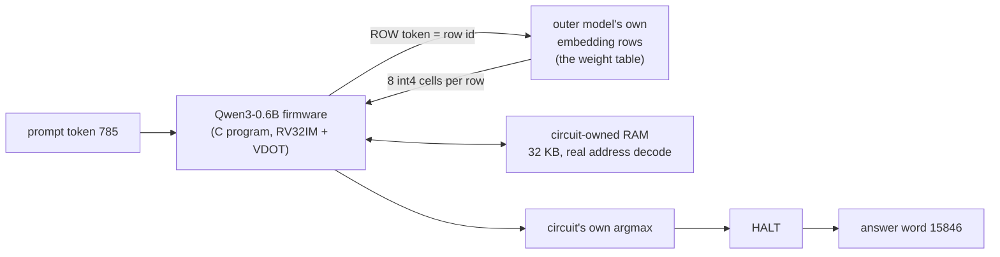

<div align="center">

# 🧠 qweninqwen

**A real Qwen3-0.6B token, computed by a CPU that lives inside the weights of another Qwen.**

`prompt token 785` → `circuit` → **`15846`** (the token Hugging Face's Qwen3-0.6B produces)

[Verdict](experiments/circuit/fullrun/logs/cfram_q_vast/FINAL_VERDICT.json) · [Reproduce](#-reproduce) · [Host roles](#-what-the-host-still-does) · [Quantisation fix](#-the-quantisation-fix) · [Credits](#-credits)

</div>

> 🎬 **Demo video:** _in production; it will be linked here from `docs/demo/`._

A homage to [Qwenputer](https://github.com/divagr18/qwenputer), where a RISC-V CPU is compiled into Qwen's weights and runs as the model generates tokens. Here that CPU runs **another language model**: a C firmware of Qwen3-0.6B (int4 weights) executes on the circuit, one instruction per generated trace token, and finishes by emitting its answer word.

## ✅ Result

| | |
|---|---|
| Outer model | Qwen3.5-4B geometry, RV32IM CPU + vector-dot unit compiled into its weights (merged checkpoint: hidden size 7680, 12 chip layers + Qwen's 32) |
| Inner model | real Qwen3-0.6B as a C firmware, prompt token `[785]` ("The"), position 0 |
| Run size | **96 chunks**, 199,287,158 trace tokens, 178,066,316 instructions |
| Ending | the circuit's own `HALT` at step 57,705 of chunk 95; final word **15846** |
| Hugging Face Qwen3-0.6B (fp32 and bf16) | **15846** (`' Question'`), the same token |
| Jobs | **96 / 96 clean**: 0 free-token mismatches, 0 forced tokens, 0 host injections |
| Seams | **95 / 95 exact**: each job's own end state equals the next job's start state (registers, pc, anchor, `n`, `wb`, latch, all 8,192 RAM words, `bn`) |
| Chunk 0 | boots from the **firmware ELF alone** (no reference state) |

The verdict is in [`FINAL_VERDICT.json`](experiments/circuit/fullrun/logs/cfram_q_vast/FINAL_VERDICT.json) and [`seams_0-95_20261107_004845.md`](experiments/circuit/fullrun/logs/cfram_q_vast/seams_0-95_20261107_004845.md); every command and run is logged in [`RUNS.md`](RUNS.md).

> 💡 **Before the fix** the same pipeline ended with **13** (`'.'`): the firmware matched its own emulator exactly, but int4 weights with int8 activations are not faithful to the real model at this prompt. See [the quantisation fix](#-the-quantisation-fix).

## 🔬 How it works



- 🖥️ **The CPU is the model.** Registers, RAM, ROM and the program counter live in the outer model's DeltaNet state. Each generated trace token is one CPU step (about 1.12 trace tokens per instruction here).
- 📦 **Weights come from the model's own parameters.** The firmware never loads weights from a host. It emits a `ROW` token naming a row; the next step embeds that row of the outer checkpoint's `embed_tokens.weight` (168,684 rows, hidden size 7680, 2.59 GB in bf16). `VDOT` consumes the row's int4 cells eight at a time. Blob constants are fetched the same way.
- 🧮 **RAM is the circuit's.** Loads read what the circuit's own stores wrote. The address decode is the real one: no `in_ram := 1` patch, no widened `in_drom`.
- 🏁 **The answer is the circuit's.** The final argmax runs in the firmware; the run stops on the circuit's own `HALT`, and the word is decoded from the circuit's own output tokens.
- ⚡ **Parallel by chunk, checked at every seam.** A chunk is 2,097,152 steps. Each of the 96 jobs runs on its own GPU and saves the circuit's own end state; the collector checks it equals the next job's seed exactly.

## 🎯 The quantisation fix

The old firmware (int4 weights everywhere, int8 activations) reproduced its emulator exactly but answered **13**, not the real model's token. Position 0 is an attention sink: the layer-2 MLP writes a massive channel (about 6,540) that stays in the residual, and layer 27 writes about 4,872.

| Variant (prompt `[785]`, real Qwen3-0.6B) | argmax |
|---|---|
| Hugging Face fp32 / bf16 | **15846** |
| HF fp32 + int4 per-row weights | 454 |
| Firmware, int4 everywhere (old) | 13 |
| Layers 2/26/27: 8-bit weights, int8 activations | 9 |
| Layers 2/26/27: int4 weights, 16-bit activations | 408 |
| **Layers 2/26/27: 8-bit weights + 16-bit activations** | **15846** |
| Layers 2/26/27: 12-bit weights + 16-bit activations | 15846 |

Both knobs are needed. The fix costs about +19% instructions per token and +7.9% weight words. Reports: [`diag_quant/REPORT.md`](experiments/circuit/fullrun/diag_quant/REPORT.md) (where the error enters), [`quantfix/REPORT.md`](experiments/circuit/fullrun/quantfix/REPORT.md) and [`quantfix/STEP2_REPORT.md`](experiments/circuit/fullrun/quantfix/STEP2_REPORT.md) (firmware, reference, checkpoint).

The merged checkpoint passes the stock-module check: 130,000 teacher-forced steps of chunk 0 through the stock `Qwen3_5` modules, the argmax taken over the full 680,128-token vocabulary, **0 mismatches** over 2,320 ROW tokens. A copy of the same check with every table entry +1 diverges at step 41 ([`hfcheck_cfq_pos_130k.json`](experiments/circuit/fullrun/quantfix/results/hfcheck_cfq_pos_130k.json), [`hfcheck_cfq_neg.json`](experiments/circuit/fullrun/quantfix/results/hfcheck_cfq_neg.json)).

## 🧑‍💻 What the host does

| Role | Why |
|---|---|
| Boot, the `GO` token, the embed-and-append loop, `ecall` I/O | 🟦 allowed by the design |
| Comparison against the reference trace | 🟦 the test, not an input |
| Later chunks' start state | 🟨 seeded from the reference, verified by exact end-state equality at all 95 seams |

Everything else runs in the circuit. Full audit with file and line references: [`docs/HOST_ROLE_AUDIT_CFRAM.md`](docs/HOST_ROLE_AUDIT_CFRAM.md).

## ⏱️ Speed and cost

| Hardware | Time per chunk | Cost per chunk |
|---|---|---|
| RTX 4090 (Vast.ai) | 6.0 min | about $0.05 |
| A100 PCIE (Vast.ai) | 4.9 to 9.7 min | about $0.06 to $0.11 |
| L40S (Vast.ai) | 8.8 min | about $0.09 |
| A100-40GB (Modal) | about 9.2 min | n/a |

The whole run cost about **$10 of rented Vast.ai GPUs** (chunks 0 to 31 and 71 to 95; the estimate is from the fleet log, not from billing). Chunks 32 to 70 ran on Modal A100s. With enough GPUs the wall time is one chunk, about 10 minutes.

## 📌 Scope

- One prompt token at position 0: the firmware is built for context length 1.
- The 96 chunks ran in parallel. Each was seeded from the reference start state and checked for exact end-state equality with the next job's seed at all 95 seams.
- The executor is the fused Triton kernel. The stock `Qwen3_5` modules were checked on chunk 0 (130,000 steps, with the negative control above).
- The outer checkpoint carries the 2.59 GB table, so it is larger than stock Qwen3.5-4B. The chunks run on Vast read the same table from `rowtab_cf.npy`, checked bit-identical to the checkpoint's `embed_tokens.weight`.

## 🔁 Reproduce

Everything is logged in [`RUNS.md`](RUNS.md). Pipeline, in order (all under [`experiments/circuit/fullrun`](experiments/circuit/fullrun)):

1. **Firmware and table:** `quantfix/gen_fx_q.py`, `quantfix/cf_gen_q.py`, `quantfix/fw_qwen3_ram_cf_q.c` build the final-contract CF+RAM firmware and the 168,684-row table ([`STEP2_REPORT.md`](experiments/circuit/fullrun/quantfix/STEP2_REPORT.md) has the exact commands and paths).
2. **Reference trace:** `quantfix/modal_refq.py` generates the 96-chunk reference (argmax 15846, 0 injections).
3. **Checkpoint:** `hfwf/merge_wf.py` merges the table into the Qwen3.5-4B checkpoint; `hfwf/check_wf.py` runs the stock-module check.
4. **Parallel run and verdict** (full details and every flag in [`cf/README_parallel.md`](experiments/circuit/fullrun/cf/README_parallel.md)):

```sh
cd experiments/circuit/fullrun
CFRAM_MAX_CONTAINERS=25 modal deploy cf/modal_cfram_par.py
python cf/spawn_cfram_parallel.py --build-cache --root R --elf E --refdir D --ckpt C --rowtab T --rowemb EMB   # once per table
python cf/spawn_cfram_parallel.py --n 96 --root R --elf E --refdir D --ckpt C --rowtab T --rowemb EMB          # detached
python cf/collect_seams.py --n 96 --root R --refvol-dir <D relative to qfr-data> --expect-word 15846           # one verdict
modal app stop -y <app id>                                                                                      # when done
```

For this run: `--elf /data/cfram_q/ramcf_q.elf --refdir /data/cfram_q/refQ --ckpt /wf/ckpt_cf_q --rowtab /data/cfram_q/cf/rowtab_cf.npy --rowemb /data/cfram_q/rowemb_q.npy --root cfram_q_par_full`. The same job can be run on rented GPUs with the scripts in [`cf/vast`](experiments/circuit/fullrun/cf/vast).

Requirements: Python 3.11, `torch`, `triton`, `transformers` 5.x, `safetensors`, [Modal](https://modal.com) (or any CUDA GPU with the same scripts), and the Qwen checkpoints in the Hugging Face cache.

## 🗺️ Repository map

```
experiments/circuit/
  fullrun/           the circuit runs: circuit_run.py, firmware (fw/, cf/, quantfix/), hfwf/ (checkpoint merge + stock-module check),
                     cf/ (parallel runner, seam collector, Vast fleet), diag_quant/, logs/, RUNS.md
  ramown/            circuit-owned RAM, real address decode (realdecode/)
  engine/ kernels/   the fused executor and Triton kernels
  compiler/ algo/    firmware generator, quantisation studies
docs/
  HOST_ROLE_AUDIT_CFRAM.md   the host-role audit of the final path
  CIRCUIT_ROUTE_PLAN.md  TIERS.md  WEIGHT_FETCH_PATH.md  CONST_FETCH_PATH.md  RAM_FIT.md
  older_compiled_route.md    the earlier compiled route (superseded)
audit/               HostGuard harness for the earlier route
reference/ older/    vendored Qwenputer lab and earlier experiments
RUNS.md              log of every launched run
```

## 🙏 Credits

- **Qwenputer** ([divagr18/qwenputer](https://github.com/divagr18/qwenputer)): the idea this repository is a homage to, a computer whose circuits are Qwen's own weights. Its compiler is vendored under `reference/nested-qwen-lab/qwentpu` with its license.
- **Qwen** models by the Qwen team at Alibaba: Qwen3.5 geometry for the outer model, Qwen3-0.6B as the inner model (Apache-2.0).
- Built on Hugging Face `transformers`, PyTorch and Triton; run on Modal and Vast.ai.

## 📜 License

Code in this repository is MIT (see [`LICENSE`](LICENSE)); vendored reference code keeps its own license file. Qwen model weights are Apache-2.0, licensed by Alibaba.

---

The earlier route, a custom giant outer model doing real fp32 matvecs with the host streaming weights, is kept for the record in [`docs/older_compiled_route.md`](docs/older_compiled_route.md).
