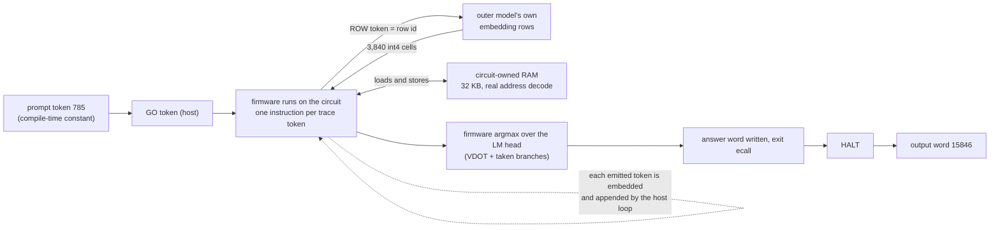

<!-- VISUAL:architecture-svg -->

  
   Schematic (box sizes are not to scale); numbers are from the run.

### Two models

| | Outer model | Inner model |
|---|---|---|
| What | a Qwen3_5-architecture transformer (widened, with added chip layers) whose weights implement a CPU | the real Qwen3-0.6B (28 layers) |
| Role | executes the machine: every generated token is one CPU step | the program the machine runs (a C firmware with its weights as data) |
| Code | the HF `transformers` `Qwen3_5` module classes, no custom layer code; only weights are written | compiled with a RISC-V toolchain, run on the circuit |

The idea comes from Qwenputer: a Gated DeltaNet layer is an associative memory, so registers, RAM and the program counter can live in the model's recurrent state, and the MLP and attention layers can implement the instruction decode, the ALU and the next-token choice. The outer model reads its own previous output tokens as the machine's trace.

### The outer model

| Property | Value |
|---|---|
| Layer design | derived from Qwen3.5-4B (hybrid Gated DeltaNet and full-attention layers) |
| Merged checkpoint | hidden size **7680**, **12 chip layers** + Qwen's **32** layers |
| Why wider than Qwen3.5-4B | the circuit's state slots and the 3,840 row cells need more residual width than the released Qwen3.5-4B's 2,560 |
| Vocabulary | **680,128** tokens (511,444 non-row tokens + the 168,684 table rows) |
| Weight table | **168,684 rows × 3,840 cells**, stored in `embed_tokens.weight` (168,684 rows × hidden 7680 × 2 bytes = **2.59 GB** in bf16) |
| Table build | `quantfix/cf_gen_q.py` (table generator) |

### The circuit

A small RISC-V machine, compiled into the outer weights, whose full state is carried between steps:

| Component | Where it lives |
|---|---|
| 32 general registers, program counter | recurrent state of the outer model |
| **RAM: 32 KB, circuit-owned** | recurrent state; loads read what the circuit's own stores wrote; real `in_ram` / `in_drom` address decode, no patch |
| Program ROM and read-only data | the firmware's code, read through the real DROM window |
| Weight and constant fetch | `ROW` tokens (below) |
| Instructions | RV32IM (+Zba) with the vector-dot instruction `VDOT` and its pointer setup `WB`; the nonlinearities run as fixed-point integer code in the firmware |
| Argmax | computed by the firmware itself with `VDOT`; a taken branch in the common case |
| Output | the firmware writes its answer word and executes the exit `ecall`; the circuit emits `HALT` |

### Trace tokens

Every instruction emits one or more tokens (the cost rules are in [`experiments/circuit/kernels/README.md`](experiments/circuit/kernels/README.md)):

| Instruction | Trace tokens |
|---|---|
| an instruction writing `rd != x0` | one value record: 1 token if `-2^14 <= v < 2^14`, 2 if `|v| < 2^29`, else 3 |
| `rd = x0`, not-taken branch, `SW` | 1 |
| taken branch, `jal`, `jalr` | 1 |
| `SB`, `SH` | 4 |
| `VDOT` | 1 record of the accumulator for 8 multiply-accumulates |
| `WB` | 1 |
| every 63rd record without a taken jump | +1 refresh token |

This run: **199,287,158 trace tokens for 178,066,316 instructions, about 1.12 tokens per instruction.**

### Weights as ROW fetches

The firmware never gets weights from a host. To read a weight row it emits a **`ROW` token** naming a row of the table. On the next step the outer model embeds that row (its `embed_tokens.weight` entry), which places 3,840 int4 cells (480 words of eight cells; an 8-bit weight uses two planes) into the residual stream. `VDOT` then consumes the latched words eight cells at a time. Weights (74.5M words) and constants are fetched this way ([`docs/WEIGHT_FETCH_PATH.md`](docs/WEIGHT_FETCH_PATH.md)). The firmware's blob constants are fetched the same way ([`docs/CONST_FETCH_PATH.md`](docs/CONST_FETCH_PATH.md)), so no blob load remains.

### Precision design

The firmware is the real Qwen3-0.6B (28 layers) compiled for the circuit's integer ISA, prompt `[785]`, context length 1.

| | |
|---|---|
| Weights | **int4** for all layers except **layers 2, 26 and 27, at 8-bit** (two int4 planes) |
| Activations | **int8**, except **layers 2, 26 and 27, at 16-bit** |
| Why those layers | at position 0 they carry the large activations (about 6,540 in the layer-2 MLP output, about 4,872 at layer 27), so they get the wider format |
| Instructions per token | **189,109,345** (compiler-level count) |
| Weight stream | **80,396,288 words** (643,170,304 weights) |
| Trace of this run | **199,287,158 tokens, 178,066,316 instructions, 96 chunks** |
| Answer for `[785]` | **15846**, matching Hugging Face Qwen3-0.6B (fp32 and bf16) |

Sources: [`quantfix/REPORT.md`](experiments/circuit/fullrun/quantfix/REPORT.md), [`quantfix/results/`](experiments/circuit/fullrun/quantfix/results/). The compiler-level count and the CF+RAM trace come from different builds and are not comparable.

### The loop

<!-- VISUAL:one-token-animation -->

  
   🎞️ <a href="docs/assets/circuit_one_token.mp4">mp4 (24 s)</a> · every frame is drawn from the real reference trace; see <a href="docs/assets/PROVENANCE.md">PROVENANCE.md</a>

The host loop only boots the machine, embeds each emitted token and appends it, and handles the `ecall` I/O. Everything between `GO` and `HALT` is decided by the circuit.

### Chunks and seams

A **chunk** is 2,097,152 steps (the jobs report 2,097,153 including the boundary step). The 199.3M-step trace is 96 chunks; the last one ends at its `HALT` after 57,705 steps. Each job runs one chunk on one GPU and saves **the circuit's own end state**. Job k+1 starts from the reference's start state for chunk k+1, and the collector checks that job k's end state equals that start state exactly: registers, pc, anchor, `n`, `wb`, the 8-word latch window, all 8,192 RAM words, and `bn`. 95 seams, 95 exact matches.

<!-- VISUAL:seam-grid -->

  
   🎞️ <a href="docs/assets/circuit_seam_grid.mp4">mp4</a> · replay of the real per-job durations as if all 96 jobs started together (the real run was staggered)

